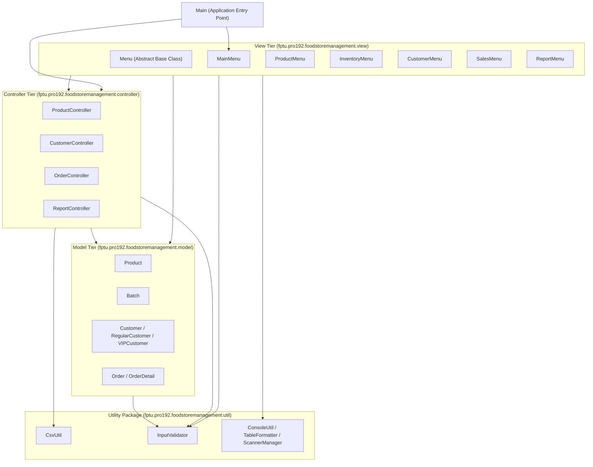

# Architecture and Data Model Specification

This document defines the 3-tier Model-View-Controller (`MVC`) architecture, the package organization, the domain and architectural UML class diagram, the Java Collections Framework usage, and the CSV file schemas for the Food Store Management System.

---

## 1. Standard 3-Tier MVC Architecture

The application is structured into three core architectural tiers (`view`, `controller`, `model`) supported by a stateless utility package (`util`) under the root package `fptu.pro192.foodstoremanagement`.

### Tier Responsibilities and Dependency Boundaries

| Package | Architectural Role | Allowed Outgoing Dependencies |
| :--- | :--- | :--- |
| `view` | Renders 80-column ASCII menus and tables, prompts the user for input via `ConsoleUtil`, catches domain exceptions, and prints status messages. Contains zero business calculation or file I/O logic. | `controller`, `model`, `util` |
| `controller` | Enforces stateful business rules (`BR1` through `BR27`), maintains in-memory `List`, `Map`, and `Set` collections, executes `FEFO` inventory deduction, and coordinates atomic CSV persistence via `CsvUtil`. Contains zero `System.out` or `Scanner` calls. | `model`, `util` |
| `model` | Encapsulates domain state, object relationships (`Product` to `Batch`, `Order` to `OrderDetail`), polymorphic behavior (`Customer.calculateDiscount`), and constructor/setter invariant checks via `InputValidator`. | `util` (`InputValidator`) |
| `util` | Provides reusable, stateless infrastructure for RFC 4180 CSV parsing and atomic file writing (`CsvUtil`), field validation and normalization (`InputValidator`), 80-column formatting (`TableFormatter`), console I/O (`ConsoleUtil`), and singleton stream management (`ScannerManager`). | Standard JDK 8 APIs only |

Consolidating business coordination and CSV persistence inside the `controller` tier keeps the architecture accessible for a four-member student team while avoiding "Fat Controllers" by delegating low-level CSV parsing and atomic file replacement to `CsvUtil` and stateless field validation to `InputValidator`.

---

## 2. UML Class Diagram

The class diagram below reflects the exact classes, fields, and method signatures in the codebase.

```mermaid
classDiagram
    direction TB

    class Product {
        -String id
        -String name
        -String category
        -String unit
        -double price
        -List~Batch~ batches
        -boolean isDeleted
        +Product(String id, String name, String category, String unit, double price)
        +Product(String id, String name, String category, String unit, double price, boolean isDeleted)
        +addBatch(Batch batch) void
        +getBatches() List~Batch~
        +getTotalStock() int
        +getAvailableStock() int
        +isLowStock(int threshold) boolean
    }

    class Batch {
        -String batchId
        -String productId
        -LocalDate importDate
        -LocalDate productionDate
        -LocalDate expirationDate
        -int quantity
        +Batch(String batchId, String productId, LocalDate importDate, LocalDate productionDate, LocalDate expirationDate, int quantity)
        +isExpired() boolean
        +isNearExpiry(int daysThreshold) boolean
        +setQuantity(int quantity) void
    }

    class Customer {
        <<abstract>>
        -String id
        -String fullName
        -String phone
        -String address
        -boolean isDeleted
        #Customer(String id, String fullName, String phone, String address, boolean isDeleted)
        +create(String type, String id, String fullName, String phone, String address, boolean isDeleted)$ Customer
        +calculateDiscount(double amount)* double
        +getCustomerType()* String
    }

    class RegularCustomer {
        +RegularCustomer(String id, String fullName, String phone, String address, boolean isDeleted)
        +calculateDiscount(double amount) double
        +getCustomerType() String
    }

    class VIPCustomer {
        + DISCOUNT_RATE : double = 0.10$
        +VIPCustomer(String id, String fullName, String phone, String address, boolean isDeleted)
        +calculateDiscount(double amount) double
        +getCustomerType() String
    }

    class Order {
        -String orderId
        -String customerId
        -LocalDateTime orderDate
        -List~OrderDetail~ items
        -double totalAmount
        -double discount
        -double finalAmount
        +Order(String orderId, String customerId, LocalDateTime orderDate)
        +Order(String orderId, String customerId, LocalDateTime orderDate, List~OrderDetail~ items, double totalAmount, double discount, double finalAmount)
        +addItem(OrderDetail item) void
        +calculateTotals(Customer customer) void
    }

    class OrderDetail {
        -String orderId
        -String productId
        -int quantity
        -double unitPrice
        +OrderDetail(String orderId, String productId, int quantity, double unitPrice)
        +getSubTotal() double
    }

    class ProductController {
        -Path productCsvPath
        -Path batchCsvPath
        -List~Product~ products
        -Set~String~ categories
        -Set~String~ units
        +loadFromCsv() void
        +saveToCsv() void
        +addProduct(Product product) void
        +updateProduct(String id, String name, String category, String unit, double price) void
        +deleteProduct(String id) boolean
        +addBatchToProduct(String productId, Batch batch) void
        +deductStockFEFO(String productId, int requestedQuantity) void
        +findById(String id) Product
        +findByIdIncludeDeleted(String id) Product
        +searchByName(String keyword) List~Product~
        +searchByCategory(String category) List~Product~
        +searchByExpirationDate(LocalDate targetDate) List~Product~
        +getAvailableProducts() List~Product~
        +getLowStockProducts(int threshold) List~Product~
        +getExpiredBatches() List~Batch~
        +getNearExpiryBatches(int daysThreshold) List~Batch~
    }

    class CustomerController {
        -Path csvPath
        -List~Customer~ customers
        +loadFromCsv() void
        +saveToCsv() void
        +registerCustomer(String id, String fullName, String phone, String address, String type) Customer
        +updateCustomer(String id, String newName, String newPhone, String newAddress, String newType) Customer
        +deleteCustomer(String id) void
        +findById(String id) Customer
        +findByIdIncludeDeleted(String id) Customer
        +findByPhone(String rawPhone) Customer
        +searchByName(String keyword) List~Customer~
    }

    class OrderController {
        -Path ordersCsvPath
        -Path detailsCsvPath
        -List~Order~ orders
        -ProductController productController
        -CustomerController customerController
        +loadFromCsv() void
        +saveToCsv() void
        +createDraftOrder(String customerId) Order
        +addItemToDraft(Order draft, String productId, int quantity) void
        +finalizeOrder(Order draft) Order
        +getAllOrders() List~Order~
    }

    class ReportController {
        -OrderController orderController
        -ProductController productController
        -CustomerController customerController
        +getOrdersByDate(LocalDate date) List~Order~
        +getDailyRevenue(LocalDate date) double
        +getOrdersByMonth(YearMonth month) List~Order~
        +getMonthlyRevenue(YearMonth month) double
        +getTopSellingProducts(int limit) List~ProductSalesSummary~
        +getCustomerSpendingSummary() List~CustomerSpendingSummary~
        +getLowStockProducts(int threshold) List~Product~
        +getExpiredBatches() List~Batch~
        +getNearExpiryBatches(int daysThreshold) List~Batch~
    }

    class Menu {
        <<abstract>>
        #String title
        #String[] options
        +display() void
        #handleChoice(int choice)* void
        #shouldPauseAfterAction() boolean
    }

    Product "1" *-- "0..*" Batch : contains
    Customer <|-- RegularCustomer : extends
    Customer <|-- VIPCustomer : extends
    Order "1" *-- "1..*" OrderDetail : contains
    Order ..> Customer : referencescustomerId
    OrderDetail ..> Product : references productId
    OrderController --> ProductController : coordinates FEFO
    OrderController --> CustomerController : resolves customer
    ReportController --> OrderController : queries orders
    ReportController --> ProductController : queries products
    ReportController --> CustomerController : queries customers
```

---

## 3. Java Collections Framework Usage

The project utilizes all three primary Java Collections interfaces (`List`, `Set`, and `Map`) across the model and controller layers:

| Collection Interface | Concrete Implementation | Usage in Codebase |
| :--- | :--- | :--- |
| `List<E>` | `ArrayList<E>` | Stores ordered collections of `Product` entities, `Batch` records inside each `Product`, `Customer` records, `Order` histories, and `OrderDetail` line items inside each `Order`. |
| `Set<E>` | `LinkedHashSet<String>` | Maintains duplicate-free, insertion-ordered registries of product `categories` and measurement `units` inside `ProductController` (`BR5`). Pre-populated with default retail grocery categories and units, and expanded dynamically when products with custom categories or units are loaded or added. |
| `Map<K, V>` | `HashMap<K, V>` / `LinkedHashMap<K, V>` | Groups `Batch` records by `productId` and `OrderDetail` records by `orderId` during CSV loading (`O(N)` join reconstruction), and aggregates product quantities and customer spending totals in `ReportController`. |

---

## 4. CSV Data Storage Schemas

All persistent data is stored in UTF-8 encoded CSV files inside the `data/` directory. Every CSV file writes a fixed header row at line 0 during save operations and skips that header row during load operations. All writes are performed atomically via `CsvUtil.writeAtomic` using a temporary sibling file (`.tmp`) and `Files.move` with `ATOMIC_MOVE` and `REPLACE_EXISTING`.

### 4.1. `data/products.csv`

Header row: `id,name,category,unit,price,isDeleted`

| Column Index | Field Name | Data Type | Format and Constraints |
| :--- | :--- | :--- | :--- |
| `0` | `id` | `String` | Primary key (`P00001` through `P99999`, `BR1`) |
| `1` | `name` | `String` | Non-empty product name (`BR3`) |
| `2` | `category` | `String` | Single-word retail category registered in `ProductController` (`BR5`) |
| `3` | `unit` | `String` | Measurement unit registered in `ProductController` (`BR5`) |
| `4` | `price` | `double` | Positive selling price in VND (`> 0`, `BR4`) |
| `5` | `isDeleted` | `boolean` | `true` if soft-deleted, `false` if active (`BR27`) |

### 4.2. `data/batches.csv`

Header row: `batchId,productId,importDate,productionDate,expirationDate,quantity`

| Column Index | Field Name | Data Type | Format and Constraints |
| :--- | :--- | :--- | :--- |
| `0` | `batchId` | `String` | Primary key (`B00001` through `B99999`, `BR6`) |
| `1` | `productId` | `String` | Foreign key referencing `products.csv(id)` (`BR18`) |
| `2` | `importDate` | `LocalDate` | ISO-8601 date `yyyy-MM-dd` (`BR7`) |
| `3` | `productionDate` | `LocalDate` | ISO-8601 date `yyyy-MM-dd`, `<= expirationDate` (`BR7`) |
| `4` | `expirationDate` | `LocalDate` | ISO-8601 date `yyyy-MM-dd`, `>= productionDate` (`BR7`) |
| `5` | `quantity` | `int` | Remaining non-negative integer stock (`>= 0`, `BR6`, `BR26`) |

### 4.3. `data/customers.csv`

Header row: `type,id,fullName,phone,address,isDeleted`

| Column Index | Field Name | Data Type | Format and Constraints |
| :--- | :--- | :--- | :--- |
| `0` | `type` | `String` | Subclass discriminator (`Regular` or `VIP`, `BR15`) |
| `1` | `id` | `String` | Primary key (`C00001` through `C99999`, `BR2`) |
| `2` | `fullName` | `String` | Non-empty customer full name (`BR3`) |
| `3` | `phone` | `String` | Normalized 10-digit Vietnamese phone number (`0[35789]xxxxxxxx`, `BR25`) |
| `4` | `address` | `String` | Non-empty residential or delivery address (`BR3`) |
| `5` | `isDeleted` | `boolean` | `true` if soft-deleted, `false` if active (`BR27`) |

### 4.4. `data/orders.csv`

Header row: `orderId,customerId,orderDate,totalAmount,discount,finalAmount`

| Column Index | Field Name | Data Type | Format and Constraints |
| :--- | :--- | :--- | :--- |
| `0` | `orderId` | `String` | Primary key (`O00001` through `O99999`, `BR8`) |
| `1` | `customerId` | `String` | Foreign key referencing `customers.csv(id)`, or `GUEST` for walk-in buyers (`BR16`) |
| `2` | `orderDate` | `LocalDateTime` | ISO-8601 timestamp (`yyyy-MM-ddTHH:mm:ss`) |
| `3` | `totalAmount` | `double` | Pre-discount gross total (`>= 0`, `BR13`) |
| `4` | `discount` | `double` | Discount amount deducted (`>= 0`, `BR13`, `BR15`) |
| `5` | `finalAmount` | `double` | Net payable amount (`totalAmount - discount`, `BR13`) |

### 4.5. `data/order_details.csv`

Header row: `orderId,productId,quantity,unitPrice`

| Column Index | Field Name | Data Type | Format and Constraints |
| :--- | :--- | :--- | :--- |
| `0` | `orderId` | `String` | Foreign key referencing `orders.csv(orderId)` (`BR8`, `BR18`) |
| `1` | `productId` | `String` | Foreign key referencing `products.csv(id)` (`BR18`) |
| `2` | `quantity` | `int` | Positive integer units purchased (`> 0`, `BR9`, `BR26`) |
| `3` | `unitPrice` | `double` | Historical unit selling price snapshot at checkout (`> 0`, `BR12`) |
